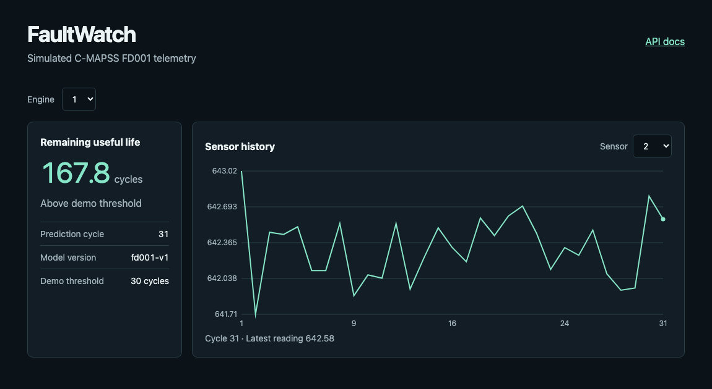
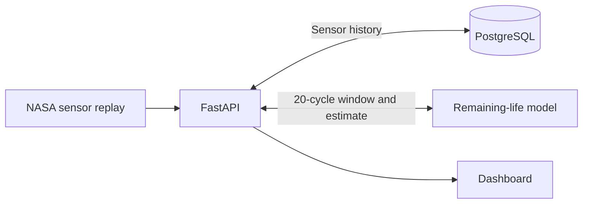

# FaultWatch

[](https://github.com/atharvj/FaultWatch/actions/workflows/ci.yml)

FaultWatch predicts how many operating cycles a simulated jet engine has left
before failure. It replays NASA sensor readings so you can watch the estimate
change as new data arrives.

[Watch the 44-second demo](docs/demo.mp4) · [Run it locally](#run-it-locally)



## How it works

1. **Replay readings.** The demo sends recorded readings from NASA's engine
   simulation one cycle at a time. FastAPI checks them and saves them in
   PostgreSQL.
2. **Estimate cycles left.** The model learned from complete simulated engine
   lifetimes. For each prediction it uses the latest 20 consecutive cycles,
   looking at each sensor's last value, average, and change over that window.
3. **Show the result.** The dashboard displays the estimate alongside sensor
   history. If an engine has fewer than 20 consecutive readings, the dashboard
   shows that it needs more history.



## Run it locally

Use Python 3.11, Docker with Compose, and uv. [Install uv](https://docs.astral.sh/uv/getting-started/installation/)

```sh
make train   # Download NASA data and train the model
make demo    # Start the API, database, and dashboard
make replay  # Send readings from three test engines
```

Open the [dashboard](http://127.0.0.1:8000) or [API docs](http://127.0.0.1:8000/docs).
`make stop` stops the demo and keeps the saved readings.

## Results

- **Prediction accuracy.** The default model missed by 19.35 cycles on average
  across 100 simulated engines held out from training. A baseline that always
  predicted the same value missed by 36.32 cycles. [Evaluation](docs/model_card.md)
- **Serving speed.** In local load tests on an Apple M2 Pro, 95% of prediction
  requests finished within about 18 ms with the C++ backend, down from 29 ms
  with Python ONNX Runtime. Both produced the same estimates across 11,196
  held-out windows. [Benchmarks](docs/benchmark.md#native-http-serving) · [Parity results](reports/native-parity.json)

## Technical guide

[Full architecture, C++ build, monitoring, deployment, and data tools](docs/technical-guide.md)
